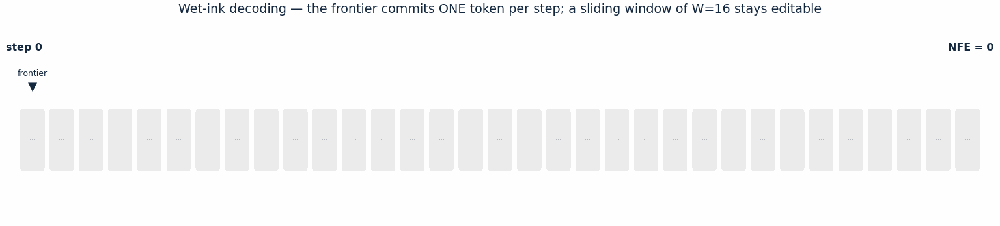

# Wet-Ink: ревизия открытых токенов — от Nemotron (v1–v3) через LLaDA2.2-mini (v4) к собственному wet-ink декодеру (v5)

[](https://huggingface.co/Freedomform/wet-ink-v5)
[](https://huggingface.co/spaces/Freedomform/wet-ink)
[](https://github.com/Asilbekov/Explore/blob/main/docs/wet-ink-report-v5.pdf)
[](https://github.com/Asilbekov/Explore/blob/main/LICENSE)

<div align="center">
  
</div>

> **EN** · Wet-Ink is an inference-time decoding method for diffusion language
> models: a one-token left-to-right **frontier** commits tokens, while a sliding
> **window of W tokens** behind it stays editable through the base model's own
> trained T2T gate; at distance W the ink **dries** — tokens freeze forever.
> Implemented on LLaDA2.2-mini with zero formula invention; paired GSM8K
> evaluation vs the stock decoder: exact McNemar **p = 1.0** at a structural
> ×4.88 NFE — an honest negative result. Full story in the
> [model card / article](https://huggingface.co/Freedomform/wet-ink-v5) and the
> [interactive demo](https://huggingface.co/spaces/Freedomform/wet-ink).

Реализация идеи **«мокрого чернила»** для `nvidia/Nemotron-Labs-Diffusion-3B`:
диффузионный фронтир открывает токены слева направо, а уже открытые токены в
ограниченном **окне ревизии** позади фронтира остаются поправимыми, пока
фронтир пишет следующий блок. Чернила у фронтира влажные, дальние — высыхают
(покидают окно). **Без переобучения, без единой собственной формулы.**

Ключевое проектное правило (задано владельцем идеи): **ни одной собственной
формулы, ни одного изменения чужих формул** — только дословные опубликованные
механизмы и комбинации, проверенные на совместимость. Каждая строка алгоритма
имеет провенанс (см. docstring `wet_ink.py` и таблицу провенанса ниже).

---

## Что случилось с v1 и почему v2 устроена иначе (кратко)

v1 применяла пороговый тест уверенности LLaDA к открытым токенам окна **на
каждом шаге** стокового порогового цикла. Качество выросло (GSM8K 86% → 92%),
но NFE взлетел в 9–19 раз: ~589 ремасков на блок при ~0,4 реальных изменений,
57% блоков упирались в аварийный лимит шагов.

**Первопричина (формально):** стоковый цикл завершим, потому что множество
масок монотонно убывает (каждый шаг коммитит ≥ 1 токен и не добавляет масок).
v1 добавила источник масок внутрь цикла и разрушила эту монотонность —
прогресс перестал быть гарантированным, цикл «churn'ил» до лимита. Формулы
были верны и дословны; **не был перенят системный инвариант завершимости** —
свойство управляющего цикла, которое каждая опубликованная система поставляет
вместе со своим правилом ревизии.

Все опубликованные системы ревизии открытых токенов парят «ревизия +
гарантия прогресса»:

| Метод | Правило ревизии | Гарантия завершимости |
|---|---|---|
| **RemeDi** (ICLR 2026, arXiv:2509.23653) | каждый шаг: keep = topk(score, k=cumsum[i]); всё вне топ-k, вкл. ранее открытые, → [MASK] | фиксированное число шагов; cumsum достигает длины блока |
| **CoDR** (EMNLP 2026, arXiv:2610.08833) | после блока: k-разделённая проба; drift = old_conf − new_conf > τ → [MASK] + заполнение | денойз-цикл стока не тронут; заполнение ограничено |
| **WINO** (Feng-Hong/WINO-DLLM) | commits: conf > 0.6; remask: conf_open < 0.9 | связка бюджетов: remask ≤ accept − 1 |
| **Saber** (ACL 2026, arXiv:2510.18165) | обмен: current_remask_k = min(unmask_k, n_open) | обменный бюджет |
| ProSeCo (NeurIPS 2026, arXiv:2602.11590) | обучаемый корректор | — (требует обучения, отвергнут) |

**v2 принимает полные опубликованные циклы** (RemeDi — основной, CoDR —
альтернатива) вместо композиции отдельных формул.

## Механизмы v2

```
generate_wet_ink(model, prompt, max_new_tokens, block_length,
                 revision_blocks=1,
                 remask_policy='reme_di',   # 'reme_di' | 'codr' | 'per_step' (v1) | 'none'
                 criterion='confidence',    # 'confidence' | 'entropy' (Dream/NVlabs)
                 threshold=0.9,             # для codr/per_step; reme_di без порога
                 drift_threshold=0.0,       # CoDR
                 num_partitions=2,          # CoDR пробы
                 denoise_steps=None)        # по умолчанию block_length (сток-правило)
```

- **`reme_di`** — цикл RemeDi над спаном [W блоков + текущий блок]: каждый шаг
  пересматривает ВСЕ позиции спана; открытыми остаются кумулятивный топ-k по
  оценке, остальное — в [MASK]. Оценка: уверенность `x0_p` (стоковая формула
  L845–846 с подстановкой x0 = текущий токен на открытых позициях — стоковая
  строка L848, семантика RemeDi) или отрицательная энтропия
  `Σ p·log(p+ε)` (Dream 7B / сэмплер NVlabs, дословно). Бюджет —
  `_get_num_transfer_tokens` по длине спана + cumsum (RemeDi). AR-сеялка
  закреплена (сток никогда не перепредсказывает позицию 0). Завершимость
  абсолютна: ровно `denoise_steps` проходов на блок.
- **`codr`** — стоковый пороговый цикл без изменений + проход CoDR после
  блока: проба разделов окна (маскируется раздел, читается p(текущий токен)),
  дрейф уверенности, заполнение стоковым сэмплером.
- **`per_step`** — v1-поведение, сохранено для воспроизводимости измерений,
  помечено как превзойдённое (нет гарантии прогресса).
- **`none`** — побитовая идентичность стоку (контракт `revision_blocks=0`
  действует для всех политик).

Инфраструктура окна — как в v1 и проверена теми же тестами: спан выровнен по
границам блоков 32, KV-кэш обрезается штатным `_crop_dynamic_cache`,
пост-блочный каузальный forward пересобирает кэш (кэш-инвариант: max err = 0).

## Локальная верификация (CPU, дословные файлы архитектуры NVIDIA)

`tests/test_smoke.py` на мини-модели из `tests/vendor/`:

| Проверка | Результат |
|---|---|
| W=0 побитово идентичен стоку (ids, NFE) — все 4 политики, включая путь раннего EOS | ✅ |
| reme_di: ровно denoise_steps проходов/блок, хвост = 0, лимиты = 0 | ✅ (66 NFE против стока 64 на 2 блока) |
| reme_di: ревизии происходят (re-liquefaction окна, смены токенов) | ✅ |
| reme_di + энтропия: работает, ранжирует отлично от уверенности | ✅ |
| codr: k проб/блок, дрейф-ремаскинг, ограниченное заполнение | ✅ (2 пробы, 29 дрейфов, NFE 95) |
| per_step (v1): churn воспроизводится для контраста | ✅ (NFE 350) |
| Кэш-инвариант (crop + rebuild) для reme_di и codr | ✅ max_abs_err = 0.0 |
| Батч B=2, детерминизм T=0 | ✅ |

Контраст на одной задаче: сток 64 → reme_di 66 → codr 95 → v1 per_step 350.

## Результаты на полной 3B (Kaggle, Tesla T4, fp16)

### v1 (GSM8K, 50 задач; сохранено для истории)

| Конфиг | Acc% | avg NFE | ремасков | реальных ревизий |
|---|---|---|---|---|
| stock (W=0), thr 0.9 | 86.0 | 67.2 | 0 | 0 |
| v1 W=1, thr 0.9 | 90.0 | 887.6 (13.2×) | 165 462 | 106 |
| v1 W=2, thr 0.9 | 88.0 | 1263.2 (18.8×) | 383 339 | 135 |
| **v1 W=1, thr 0.8** | **92.0** | 612.6 (9.1×) | 92 009 | 51 |
| v1 W=1, thr 0.95 | 88.0 | 1020.9 (15.2×) | 204 702 | 209 |

### v2 (тот же протокол; кёрнел версии 2)

| Конфиг | Acc% | avg NFE | Реальных ревизий | Исправлено/сломано |
|---|---|---|---|---|
| stock (W=0), t=0.9 | 86.0 | 67.2 (1.0×) | 0 | — |
| v2 RemeDi W=1, 32 шага | 82.0 | 196.1 (2.9×) | 3 279 | 4 / 6 |
| v2 RemeDi W=1, 16 шагов | 76.0 | 96.0 (1.4×) | 3 091 | 3 / 8 |
| v2 RemeDi W=1, энтропия, 16 шагов | 78.0 | 93.0 (1.4×) | 1 726 | 4 / 8 |
| **v2 CoDR W=1, τ=0** | 82.0 | **76.6 (1.14×)** | 35 | 2 / 4 |
| v2 RemeDi W=2, 16 шагов | 58.0 | 99.8 (1.5×) | 7 643 | 2 / 16 |

**Честные итоги v2.** Цель по затратам достигнута в точности: NFE лёг в
расчётные границы (гарантия завершимости работает — без хвостов и лимитов),
эквивалентность W=0 ≡ сток подтверждена на реальной модели для всех политик.
Качество при коротком блоке 32 — чисто отрицательное: ревизионный сигнал
реален (задачи №7, 21, 43, 46 исправляются), но агрессивное разжижение окна
(reme_di переписывает ~12 из 32 токенов окна за блок) размазывает локальную
связность; W=2 — катастрофа (58%). Это эмпирически подтверждает калибровку
«Re-evaluating Confidence Remasking» (NeurIPS 2026): при жадном декодировании
и коротких блоках training-free ревизия не даёт чистого выигрыша, узкое место —
сама модель (RemeDi в оригинале обучалась под ремаскинг; Nemotron — нет).
Итоговая карта компромиссов: v1 W=1@0.8 — максимум качества (92%) при 9× NFE;
сток — лучшая дешёвая конфигурация; CoDR — ближайший к «бесплатному» вариант
ревизии (1.14×). Главный непроверенный режим — длинные блоки (64/128), где по
литературе ревизия начинает выигрывать. Полный разбор — в техническом отчёте
`docs/wet-ink-report.pdf`.

---

## v3: полный бенчмарк на Nemotron (GSM8K n=200 + HumanEval 164)

Прогон `kaggle/` (Tesla T4, fp16, 15 конфигураций, 2 820 генераций). Протоколы и
статистика: точный McNemar на парных задачах, Wilson 95% CI, NFE-бухгалтерия.

| Конфиг | GSM8K acc | NFE | McNemar vs сток |
|---|---|---|---|
| сток b32 (t=0.9) | **86.5%** | 64.9 | — |
| CoDR W=1 b32 | 86.5% | 79.5 | p=1.0 (8/8) |
| RemeDi W=1 b32 | 74.0% | 193.0 | **p=0.0002** (10/35) |
| сток b64 | 85.5% | 63.5 | — |
| CoDR W=1 b64 | 87.0% | 68.6 | p=0.55 (7/4) |
| RemeDi W=1 b64 | 70.0% | 202.5 | **p<0.0001** (7/38) |
| сток b128 | 81.0% | 73.4 | — |
| CoDR W=1 b128 | 78.5% | 78.0 | p=0.23 (3/8) |
| RemeDi W=1 b128 | 55.0% | 218.2 | **p<0.0001** (18/70) |

HumanEval (164 задачи): сток b32 44.5%, CoDR b32 43.9% (нейтрален), RemeDi
b32 25.0% (p<0.0001, −19.5 п.п.). Эквивалентность W=0 ≡ сток — битовая, все
политики. Полные данные: `results/results_v3.json`.

**Вывод v3:** на Nemotron training-free ревизия при жадном декодировании либо
нейтральна (CoDR), либо значимо вредна (RemeDi) — в точности по калибровке
NeurIPS 2026 (арXiv:2606.12232): «узкое место — сама dLLM, а не правило
ремаскинга». Сигнал ревизии реален (задачи, чинимые всеми конфигами, есть),
но без обучения под ремаскинг агрессивное разжижение окна рушит связность.

## v4: смена базы по правилу (г) — LLaDA2.2-mini

Правило (г) расширено владельцем идеи: **если новая база уже содержит обученный
механизм для нашей задачи и он лучше — берём базу со всеми её формулами, а
устаревший внешний цикл отбрасываем.**

Новая база `inclusionAI/LLaDA2.2-mini` (16B MoE / 1.4B активных, Apache 2.0)
содержит **Levenshtein Editing** (токены DELETE/SPLIT, обучение L-EBPO):
встроенный T2T-гейт `t2t_index = (p0 > editing_threshold) & (old != x0)`
— это confidence-гейт идеи wet-ink, но *обученный* и ограниченный
(`max_post_steps`, антилуп-ресемплер, подавление SPLIT/DELETE на финальном
раунде, детектор остаточных спец-токенов). Окно правки = текущий блок
(`block_length`) — ровно «мокрое чернило».

Что отброшено как дубликат встроенного механизма: **RemeDi** и **CoDR**.
Что переносится без изменений: протоколы GSM8K/HumanEval, точный McNemar +
Wilson CI, NFE-бухгалтерия. «Методы поверх базы» = конфигурация собственных
параметров `generate()` модели: `block_length` ∈ {32,64,128},
`editing_threshold` ∈ {0.0, 0.5, 0.7, 2.0=OFF}, `max_post_steps` ∈ {16, 4},
`threshold` ∈ {0.5, 0.9}.

Железо: **2×Tesla T4, 8-бит (bitsandbytes int8), eager attention**
(SDPA отвергает bf16-маску редактирования; eager промоутит её в fp32 —
собственный путь внимания модели). Замер пайплайна: ~3.8–4.2 с на прямой
проход → сетка core-first с адаптивными капами (планировщик `plan_n`).

Локальная верификация механики (tiny-модель той же архитектуры, 20.3M,
случайные веса): все 9 конфигов завершаются, 0 остаточных спец-токенов,
жадное декодирование детерминировано, bf16-маска+fp16 совместимы,
int8 не трогает MoE-роутер (сырой nn.Parameter в fp32). Код:
`scripts/test_llada22_tiny.py` (в песочнице), ядро: `kaggle_v4/kernel.py`.

**Итог v4b (COMPLETE, 7,30 ч, 403 генерации в 10 руках из 12).** Прогон на
2×T4 в **4-бит NF4** (по полной модели на каждой T4, два независимых
воркера, приоритетная очередь + адаптивный планировщик `plan_n`). P0-пара
(n=80+80): встроенный T2T-гейт **не сдвигает качество** — stock 22,5% против
noedit 23,8% (−1,2 п.п., McNemar p = 1,0; 3 исправлено / 4 сломано);
экономический сигнал устойчив: **−15% NFE (×0,85) и −15% времени**.
Абляции порогов (0,5/0,7), блок 64, mps4 — в пределах шума; порог M2T 0.9
удваивает NFE и режет точность. Конфаунд: gen_length=160 усекает 82–86%
генераций; среди естественно завершённых (EOS) верны 96%.
Полные данные: `results/results_v4.json`, анализ: `scripts/analyze_v4.py`.

Главный концептуальный вывод v4b: штатный `generate()` LLaDA2.2 — ещё не
wet-ink из §2.1: окно правки = текущий блок, блок закрылся — чернила
высохли, окно не скользит за фронтиром. Никакая конфигурация штатных
параметров (12 рук) этого не меняет: расписание открытия токенов зашито в
transfer schedule. → v5: собственный цикл декодирования.

## v5: собственный wet-ink декодер (freedomform/wet-ink-v5)

**Опубликовано:** карточка-статья и все артефакты —
[🤗 Freedomform/wet-ink-v5](https://huggingface.co/Freedomform/wet-ink-v5),
интерактивная демо —
[🤗 Space Freedomform/wet-ink](https://huggingface.co/spaces/Freedomform/wet-ink).

Ядро `kaggle_v5/kernel.py` (1 153 строки) — первый собственный цикл
декодирования в проекте, целиком из штатных формул модели (правило (г)
соблюдено: новые формулы не вводились, изменён только порядок применения
штатных гейтов):

- **фронтир** открывает **ровно один токен за шаг** — левейшую маску
  открывает M2T-гейт самой модели;
- позади фронтира — **скользящее окно W**, в котором открытые токены
  продолжает править обученный T2T-гейт (`p0 > editing_threshold &
  old != x0`, дословно);
- за окном чернила сухие: `editing_confidence = -inf` вне `[f−W, f)` —
  жёсткое высыхание с расстоянием, как в идее §2.1;
- блок-диагональное внимание, `max_post_steps=4`, KV-обрезка — дословно из
  кода модели; телеметрия `steps/opened/rewrites/resid` на каждую задачу.

**Прогон (COMPLETE):** старт 7 ноября 11:46:56 UTC, цикл 6 ч 04 м из бюджета
7,5 ч; 77 генераций в трёх руках; руки w32 и HumanEval пропущены
планировщиком честно (`n_run=5 < 8` — «skipped: time budget»).

| Рука | n | Точность | Wilson 95% | Ср. NFE | Реврайты/зад |
|---|---|---|---|---|---|
| wetink_w16 (гипотеза, W=16) | 45 | **24,4%** | [14,2; 38,7] | 206,6 | 6,9 |
| wetink_noedit_w16 (фронтир без правки) | 22 | 13,6% | [4,7; 33,3] | 201,1 | 0 |
| wetink_w8 (узкое окно) | 10 | 20,0% | [5,7; 51,0] | 202,7 | 5,6 |
| stock_b32 (v4b, базлайн) | 80 | 22,5% | [14,7; 32,8] | 42,5 | — |
| noedit_b32 (v4b, базлайн) | 80 | 23,8% | [15,8; 34,1] | 50,1 | — |

Парный точный McNemar (по индексу задач; модель/квантизация/промпты идентичны
v4b): wetink_w16 vs stock_b32 — **11/45 = 11/45** (2 исправлено / 2 сломано,
**p = 1,0**) при цене **×4,88 NFE** (42 → 207); контроль фронтира vs сток —
тоже p = 1,0. Ключевая методологическая находка: видимые +10,8 п.п. к
внутреннему контролю — **артефакт состава задач** (контроль остановился на
трудных задачах 0–21; на них все руки дают 13,6%, на лёгких 22–44 — 34,8%);
на общих задачах правки в окне **не перевернули ни одного исхода** — 0
расхождений из 22 пар, хотя реврайты реально происходят (6,9 на задачу,
churn 5,6). Механика подтверждена: ids_equal=True, resid=0 во всех 77
генерациях.

**Вердикт v5:** декодер wet-ink реализует идею §2.1 в точности и парно
сохраняет качество штатного параллельного декодера (третий виток подряд:
training-free ревизия нейтральна/вредна — штатный блочный гейт нейтрален —
скользящее окно с тем же гейтом нейтрально); цена ×4,88 NFE — структурная,
без churn-взрыва v1 (13,2×). Данные: `results/results_v5.json`, анализ:
`scripts/analyze_v5.py`, вырезка лога: `results/v5_kernel_log_excerpt.txt`,
отчёт: `docs/wet-ink-report-v5.pdf`.

## v6 (направление, не запускано)

Правило (в) запрещает модифицировать обученный гейт, а v4b + v5 показали,
что пороги качество не двигают. Остаётся структурный рычаг: фронтир,
открывающий k > 1 токенов за шаг (NFE ÷ k без новых формул), патч
телеметрии — гистограмма реврайтов по дистанции до фронтира (прямой профиль
высыхания), n ≥ 500 на руку для мощности (CI сузится с ±12 до ±4 п.п.).


## Провенанс (каждая формула — источник)

| Элемент | Источник (дословно) |
|---|---|
| Gumbel-argmax x0, уверенность x0_p, подстановка x0 на открытых | `modeling_nemotron_labs_diffusion.py` L842–848 |
| Пороговый коммит + форс топ-1 | там же, L852–860 (= LLaDA low_confidence) |
| Чётное разбиение бюджета, остаток вперёд | `_get_num_transfer_tokens` L824–832 (= LLaDA `get_num_transfer_tokens`) |
| Цикл keep = topk(score, cumsum), x = where(keep, x0, [MASK]) | RemeDi, официальный inference.py L64–90 (ICLR 2026) |
| Оценка открытых позиций = p(текущий токен) | семантика RemeDi (upm) через стоковую формулу x0_p |
| Энтропия score = Σ p·log(p+ε), ε=1e-10 | сэмплер NVlabs `neg_entropy` (= Dream 7B) |
| Пробы разделами, drift = old_conf − new_conf > τ, заполнение | CoDR, официальный codr/generation.py (EMNLP 2026) |
| Обрезка KV-кэша | `_crop_dynamic_cache` L803–811 (паттерн linear_spec_generate L775) |
| AR-сеялка, каузальный префикс, пост-блочный forward | сток `generate()` L421–519 |

Отвергнуто (с зафиксированными причинами): ProSeCo и GIDD и Diffusion Forcing
(обучение); Rolling Diffusion (доменный сдвиг = модификация чужой формулы);
порог на энтропии (не опубликован ни в одной системе — смешение шкал);
дистанционно-затухающие расписания (см. выше). Калибровка ожиданий:
«Re-evaluating Confidence Remasking» (NeurIPS 2026, arXiv:2606.12232) — на
коротких блоках при жадном декодировании выигрыш ревизии минимален.

## Структура

```
wet_ink.py                  # ядро v2: generate_wet_ink() c remask_policy
tests/
  test_smoke.py             # CPU-верификация (см. выше)
  make_tiny_repo.py         # сборка мини-модели на vendor-файлах
  vendor/                   # дословные файлы архитектуры NVIDIA (Apache-2.0, NOTICE.md)
kaggle/
  kernel_harness.py         # стенд v2: sanity→эквивалентность→GSM8K (6 конфигураций)
  kernel-metadata.json
  kernel.py                 # собранный кёрнел (wet_ink.py + kernel_harness.py)
kaggle_v4/
  kernel.py                 # ядро v4b: LLaDA2.2-mini, 2×T4, 4-бит NF4, 2 воркера, plan_n
  kernel-metadata.json
kaggle_v5/
  kernel.py                 # ядро v5: собственный wet-ink декодер (фронтир 1 токен/шаг + окно W)
  kernel-metadata.json
results/
  results.json              # прогон v1 (T4, fp16)
  results_v2.json           # прогон v2 (T4, fp16)
  results_v3.json           # прогон v3 (T4, fp16): 15 конфигов, GSM8K-200 + HumanEval-164
  results_v4.json           # прогон v4b (2×T4, NF4): 10 рук, 403 генерации
  results_v5.json           # прогон v5 (2×T4, NF4): wet-ink декодер, 3 руки, 77 генераций
  v5_kernel_log_excerpt.txt # вырезка лога ядра v5 (полный лог ~9 МБ в Kaggle output)
scripts/
  summarize_results.py
  analyze_v4.py             # McNemar-анализ v4b vs noedit-контроль
  gen_report_v4.py          # генератор отчёта v4.0 (ReportLab + Playwright-обложка)
  make_chart_v4.py          # чарт результатов v4b
  analyze_v5.py             # парный McNemar v5 против базлайнов v4b
  gen_report_v5.py          # генератор отчёта v5.0
  make_chart_v5.py          # чарт результатов v5
docs/
  wet-ink-report-v3.pdf     # отчёт v3.0 (Nemotron)
  wet-ink-report-v5.pdf     # отчёт v5.0 (полный: v3 + v4b + v5)
  wet_ink_decoding.gif      # анимация декодера (баннер HF-карточки и этого README)
  chart_v5_gsm8k_en.png     # чарт результатов v5 (EN, для карточки HF)
```

## Воспроизведение

```bash
# локально (CPU, ~1 мин, без весов)
python tests/test_smoke.py

# на GPU (полная модель)
from wet_ink import generate_wet_ink
out, nfe, stats = generate_wet_ink(model, ids, max_new_tokens=256, block_length=32,
                                   revision_blocks=1, remask_policy="reme_di",
                                   eos_token_id=tok.eos_token_id, return_stats=True)
```

Требования: `torch ≥ 2.5`, `transformers == 5.0.0`, GPU ≥ 16 ГБ для 3B в fp16.

## Future work

1. v6 — структурное удешевление фронтира: k > 1 токенов за шаг (NFE ÷ k, без
   новых формул) при сохранении скользящего окна.
2. Патч телеметрии v6: гистограмма реврайтов по дистанции до фронтира —
   прямой замер профиля высыхания «чернил».
3. n ≥ 500 на руку для статзначимости (CI ±12 → ±4 п.п.).
4. Fast-dLLM-кэш поверх LLaDA2 (ортогонально правке).

## Источники

- **Wet-Ink v5 на Hugging Face**: карточка-статья
  [Freedomform/wet-ink-v5](https://huggingface.co/Freedomform/wet-ink-v5),
  интерактивная демо [Freedomform/wet-ink](https://huggingface.co/spaces/Freedomform/wet-ink)

- Nemotron-Labs-Diffusion: модель `nvidia/Nemotron-Labs-Diffusion-3B` (HF),
  github.com/NVlabs/Nemotron-Labs-Diffusion (Apache-2.0)
- RemeDi: arXiv:2509.23653 (ICLR 2026), github.com/maple-research-lab/RemeDi
- CoDR: arXiv:2610.08833 (EMNLP 2026), github.com/YueWu0301/CoDR
- WINO: github.com/Feng-Hong/WINO-DLLM
- Saber: arXiv:2510.18165 (ACL 2026), github.com/zhaoyMa/Saber
- LLaDA: Nie et al., NeurIPS 2025, github.com/ML-GSAI/LLaDA
- LLaDA2.2-mini: inclusionAI (2026), huggingface.co/inclusionAI/LLaDA2.2-mini —
  Levenshtein Editing (DELETE/SPLIT), L-EBPO, Apache 2.0; код модели изучен дословно
- Dream 7B: arXiv:2508.15487, github.com/HKUNLP/Dream
- ProSeCo: arXiv:2602.11590 (NeurIPS 2026), github.com/kuleshov-group/proseco
- Re-evaluating Confidence Remasking: arXiv:2606.12232 (NeurIPS 2026),
  github.com/stipefrkovic/remasking-dllm
- Fast-dLLM: arXiv:2505.22618 (ICLR 2026); APD: arXiv:2506.00413 (NeurIPS 2025);
  Jump Your Steps: arXiv:2410.07761 (ICLR 2025)
- GIDD: arXiv:2504.12210 (ICML 2025); Rolling Diffusion: ICML 2024;
  Diffusion Forcing: NeurIPS 2024

## Лицензия

Код этого репозитория — MIT. `tests/vendor/` — дословные копии файлов NVIDIA
(Apache-2.0, см. `tests/vendor/NOTICE.md`). Веса модели подчиняются NVIDIA
Open Model License и в репозиторий не входят.
